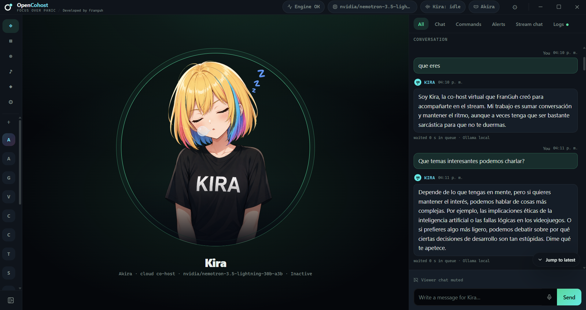

# OpenCohost UI

The desktop front end of [OpenCohost](https://github.com/plynte-labs/OpenCohost), a local-first AI streaming co-host (Kira): a Tauri 2 shell around a React app. It is the product surface, and the only one.

> Open beta. Things will break and some panels are further along than others. Bug reports, questions and front-end contributions are welcome: [open an issue](../../issues) with a screenshot and what you were doing.



## How it fits together

This repo is a git submodule of the [OpenCohost repository](https://github.com/plynte-labs/OpenCohost), checked out at `OpenCohost_UI/`. That repo holds the Python engine, the HTTP API (`opencohost.api.main:app`), the installer pipeline and the product documentation. This repo holds only the UI.

The React app never talks to a model. It drives the engine over a local HTTP API, and the Tauri shell puts that API there:

```
React (src/)  --HTTP-->  127.0.0.1:8765  <--spawns--  src-tauri/src/backend/
                         opencohost.api.main:app
```

On startup the shell probes ports 8765 and 8770. If a healthy backend already answers it reuses it. Otherwise it spawns `python -m uvicorn opencohost.api.main:app` itself and stops it on exit. On first run, a setup wizard (`src/features/setup/`) walks the user through language, model and persona choices.

## Prerequisites

- [Node.js](https://nodejs.org/) (current LTS) and [pnpm](https://pnpm.io/) 11.5.2 (pinned in `packageManager`; `corepack enable` picks it up)
- [Rust](https://rustup.rs/) (stable, unpinned) and the MSVC C++ Build Tools
- [WebView2 Runtime](https://developer.microsoft.com/microsoft-edge/webview2/) (included in Windows 11)
- A working Python environment for the engine, set up as described in the root repo (the `api` extra is required)

## Development

Clone the root repo with submodules, then:

```powershell
cd OpenCohost_UI
pnpm install
pnpm tauri:debug
```

`pnpm tauri:debug` needs nothing else running. It starts `tauri dev` with `OPENCOHOST_DEBUG=1` and warns you if something already listens on 8765/8770, because the shell would reuse that backend and debug-only logging would not reach it.

### Pointing at your Python interpreter

By default the shell uses the tracked `src-tauri/backend.config.default.json` (`python` from `PATH`, working directory `..`). If your engine lives in a conda env or venv that is not first on `PATH`, create `src-tauri/backend.config.json` (git-ignored):

```jsonc
{
  "python_path": "C:\\path\\to\\your\\env\\python.exe",
  "working_dir": "C:\\path\\to\\OpenCohost",
  "app_module": "opencohost.api.main:app",
  "port": 8765,
  "fallback_port": 8770,
  "spawn": true
}
```

`OPENCOHOST_BACKEND_CONFIG` overrides both files if you keep the config elsewhere.

## Scripts

| Script | What it does |
|---|---|
| `pnpm tauri:debug` | Desktop app in dev mode (spawns the backend) |
| `pnpm dev` | Vite dev server on `:1420`, for front-end work against a backend you started yourself |
| `pnpm build` | `tsc` plus `vite build` |
| `pnpm test` | `vitest run` |
| `pnpm gen:api` | Regenerate `src/api/types.gen.ts` from a live backend on `:8765` |
| `pnpm gen:api:offline` | Regenerate the types from the committed `openapi.snapshot.json` (runs before `build` and `test`) |
| `pnpm check:api` | Fail if the live backend has drifted from the snapshot |
| `pnpm build:phone-avatar` | Build the phone avatar bundle |

If `check:api` fails, the backend contract changed: run `pnpm gen:api` and commit the snapshot and the regenerated types together with the engine-side change.

## Tests

```powershell
pnpm exec tsc --noEmit
pnpm exec vitest run
cd src-tauri; cargo test
```

## Project layout

```
src/
  api/        typed API client and generated types
  features/   one folder per surface
  i18n/       English and Spanish bundles (per-surface .en.ts / .es.ts)
src-tauri/
  src/        Rust shell: backend supervisor, first run, provisioning,
              runtime, desktop companion
  resources/  bundled resources, including the Kira VRM
public/       animations, avatar states, boot and brand art
```

Surfaces under `src/features/`: `agenda`, `avatar-vrm`, `commands`, `controles`, `desktop-companion`, `experiencia`, `memoria`, `models`, `musica`, `perfiles`, `remote`, `setup`, `shell`, `stream`, plus `shared`. `shell` holds the composition root and `BackendGate`, which blocks the app until `GET /api/health` reports the engine alive.

Rule of thumb: do not reach around the API. The UI owns no engine state; if an endpoint is missing, that is a backend change in the root repo.

`preview-static.html` and `preview-alt-aurora.html` are historical design explorations. They are not built and not a spec for the current UI.

## Installer

`pnpm tauri build` produces an NSIS installer for the desktop shell only. The end-user installer, which also bundles the engine, is built by CI in the root repo and published on its [releases page](https://github.com/plynte-labs/OpenCohost/releases). Release builds are unsigned, so Windows SmartScreen may show an "Unrecognized app" warning. See the root README for installation and upgrade notes.

## Assets and licenses

The code is MIT, see [`LICENSE`](LICENSE). Some assets carry other terms:

- **Kira VRM** (`src-tauri/resources/vrm/`): first-party, VRM Public License 1.0 with the permissions embedded in the file (attribution required: "Kira by FranGuh"; see the root THIRD-PARTY-NOTICES.md).
- **Animations** (`public/animations/`): the `.vrma` clips come from a CC0 motion pack by rerofumi (credited anyway) plus a CC0 idle loop. The pixiv VRoid motion pack is not distributed; without it the avatar falls back to the CC0 clips. Per-file terms: [`public/animations/THIRD_PARTY_LICENSES.md`](public/animations/THIRD_PARTY_LICENSES.md).
- **Kira artwork** (`kira-*` images in `public/`): AI-generated for this project, not MIT and not covered by the VRM license. It is distributed only as part of OpenCohost and may not be reused outside it without the owner's permission.

The root repo's `THIRD-PARTY-NOTICES.md` is the full statement of record.
